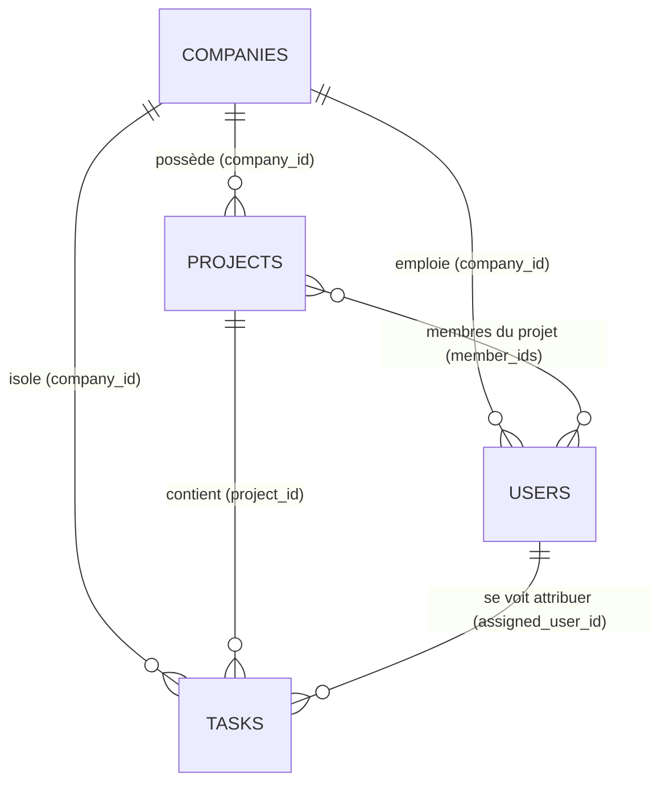

# Spécification Technique - Architecture Base de Données MongoDB

> **BUT 3 Informatique — R5.10 : Nouveaux paradigmes de bases de données**  
> **TD1 : Startup – Outil de gestion de projet SaaS – PARTIE I**

---

## 1. Choix du paradigme et principes d'architecture

Le système repose sur **MongoDB 7.0**, un système de gestion de base de données orienté documents (NoSQL), particulièrement adapté aux structures hiérarchiques et évolutives d'un outil SaaS de gestion de projet (Entreprises ➔ Utilisateurs & Projets ➔ Tâches Kanban).

### 1.1 Isolation Logicielle Multi-Tenant (Tenant-Discriminator)
Pour garantir une **isolation logicielle stricte** sans surcoût d'infrastructure (base partagée, collections partagées), chaque document métier (`users`, `projects`, `tasks`) intègre un identifiant d'entreprise obligatoire : `company_id`.
- **Principe d'étanchéité** : Aucune requête de lecture, écriture, modification ou suppression ne peut être exécutée sans injecter le `company_id` validé par le token JWT de l'utilisateur authentifié.
- **Suppression en cascade** : La suppression d'une entreprise via `/companies/me` entraîne la suppression immédiate et atomique des tâches, projets et utilisateurs liés à ce `company_id`.



---

## 2. Anticipation de la Réplication et du Sharding (Partie II)

Conformément aux exigences du sujet pour la Partie II (passage à un environnement distribué avec réplication et montée en charge par sharding) :

### 2.1 Configuration Dynamique de la Connexion (Zéro Modification de Code)
La connexion à MongoDB est entièrement externalisée via la variable d'environnement `MONGO_URI` (définie dans le fichier de configuration `.env` ou `compose.yml`).

- **Environnement Standalone (TD1 Partie I)** :
  ```env
  MONGO_URI=mongodb://mongodb:27017
  MONGO_DB_NAME=saas_pm_db
  ```
- **Environnement Replica Set (Haute Disponibilité)** :
  ```env
  MONGO_URI=mongodb://mongo1:27017,mongo2:27017,mongo3:27017/?replicaSet=rs0
  MONGO_DB_NAME=saas_pm_db
  ```
- **Environnement Cluster Shardé (Distribution Horizontale)** :
  ```env
  MONGO_URI=mongodb://mongos1:27017,mongos2:27017
  MONGO_DB_NAME=saas_pm_db
  ```

Le pilote asynchrone officiel `Motor` (`AsyncIOMotorClient`) gère nativement le pool de connexions, la détection automatique du nœud primaire (Primary) lors d'un failover de replica set, et le routage transparent via les routeurs `mongos`.

### 2.2 Stratégie de Partitionnement (Clé de Sharding)
Dans une architecture multi-tenant SaaS, la clé de partitionnement naturelle est le **Tenant ID** (`company_id`) :
- **Clé de Sharding recommandée** : `{"company_id": "hashed"}` ou `{"company_id": 1, "_id": 1}`.
- **Routage ciblé** : Grâce à cette clé, toutes les requêtes d'une entreprise ciblent un shard précis sans déclencher de requêtes globales dispersées ("scatter-gather"), préservant les performances à grande échelle.
- **Indexation orientée Sharding** : L'ensemble des index composés de l'application intègre `company_id` en première position (préfixe d'index).

---

## 3. Collections et Structures de Données JSON

### 3.1 Collection `companies` (Entreprises clientes / Tenants)
Stocke les entités clientes de la plateforme.

```json
{
  "_id": { "$oid": "6727b14d2b270769a68a25c1" },
  "name": "Acme Technologies",
  "description": "Entreprise spécialisée dans les solutions cloud",
  "created_at": { "$date": "2026-11-03T18:00:00.000Z" },
  "updated_at": { "$date": "2026-11-03T18:00:00.000Z" }
}
```

**Index définis :**
- `{"name": 1}` : Index unique assurant l'unicité du nom d'entreprise sur la plateforme.

---

### 3.2 Collection `users` (Utilisateurs & Collaborateurs)
Stocke les comptes utilisateurs, avec hachage sécurisé du mot de passe (bcrypt avec sel) et rattachement immuable à une entreprise.

```json
{
  "_id": { "$oid": "6727b14d2b270769a68a25c2" },
  "email": "alice@acme.com",
  "full_name": "Alice Dupont",
  "hashed_password": "$2b$12$e8YkZ8zT0h9P1KqR1yXnO.e...",
  "role": "admin",
  "company_id": { "$oid": "6727b14d2b270769a68a25c1" },
  "is_active": true,
  "created_at": { "$date": "2026-11-03T18:05:00.000Z" }
}
```

**Index définis :**
- `{"email": 1}` : Index unique garantissant l'unicité de l'adresse de messagerie.
- `{"company_id": 1}` : Index d'isolation logicielle et de jointure logique.

---

### 3.3 Collection `projects` (Projets de l'entreprise)
Stocke les espaces de travail projets d'une entreprise et la liste des collaborateurs assignés.

```json
{
  "_id": { "$oid": "6727b14d2b270769a68a25c3" },
  "name": "Refonte Portail Client",
  "description": "Migration vers une architecture moderne",
  "company_id": { "$oid": "6727b14d2b270769a68a25c1" },
  "member_ids": [
    "6727b14d2b270769a68a25c2",
    "6727b14d2b270769a68a25c4"
  ],
  "created_at": { "$date": "2026-11-03T18:10:00.000Z" },
  "updated_at": { "$date": "2026-11-03T18:10:00.000Z" }
}
```

**Index définis :**
- `{"company_id": 1, "name": 1}` : Index composé pour la recherche par projet au sein d'une entreprise. Ce préfixe couvre également toutes les requêtes filtrées sur `company_id` seul.

---

### 3.4 Collection `tasks` (Tâches du Tableau Kanban)
Représente les cartes du tableau Kanban. Chaque tâche est rattachée à un projet et à une entreprise, dispose d'un statut d'avancement et d'un utilisateur assigné.

```json
{
  "_id": { "$oid": "6727b14d2b270769a68a25c5" },
  "title": "Concevoir le schéma NoSQL",
  "description": "Définir les collections JSON et index pour MongoDB",
  "status": "IN_PROGRESS",
  "priority": "HIGH",
  "project_id": { "$oid": "6727b14d2b270769a68a25c3" },
  "company_id": { "$oid": "6727b14d2b270769a68a25c1" },
  "assigned_user_id": "6727b14d2b270769a68a25c2",
  "created_at": { "$date": "2026-11-03T18:15:00.000Z" },
  "updated_at": { "$date": "2026-11-03T18:20:00.000Z" }
}
```

**Valeurs des énumérations :**
- `status` : `"TODO"`, `"IN_PROGRESS"`, `"REVIEW"`, `"DONE"`
- `priority` : `"LOW"`, `"MEDIUM"`, `"HIGH"`, `"URGENT"`

**Index définis :**
- `{"company_id": 1, "project_id": 1, "status": 1}` : Index composé optimisé pour le chargement instantané des colonnes Kanban, servant également de support pour le sharding.
- `{"assigned_user_id": 1}` : Index permettant de lister rapidement les tâches assignées à un utilisateur donné.
