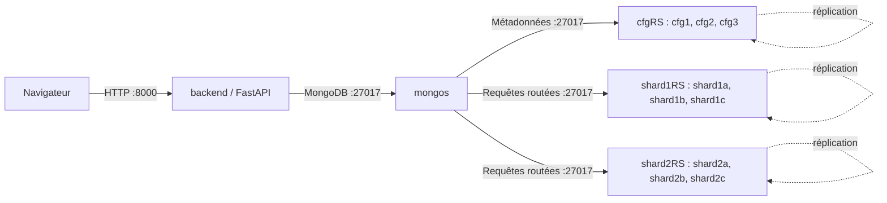

# Spécification technique — Partie II

**Projet :** FlowSaaS, outil SaaS de gestion de projets  
**Base de données :** MongoDB 7.0  
**Application :** FastAPI / Motor

## 1. Objectif

Cette évolution apporte la haute disponibilité et la distribution horizontale des données MongoDB sans modifier les fonctionnalités métier de la partie I. L'application se connecte à un point d'entrée unique, `mongos`, configuré par `MONGO_URI`.

## 2. Architecture des serveurs

Le fichier `compose.yml` démarre les composants ci-dessous par `docker compose up -d --build`.

| Composant | Services Compose | Configuration et fonction |
|---|---|---|
| API FlowSaaS | `backend` | FastAPI, port HTTP 8000 ; MongoDB via `mongos:27017`. |
| Routeur MongoDB | `mongos` | Point d'entrée du cluster ; reçoit les requêtes applicatives et les dirige selon les métadonnées et clés de shard. |
| Replica Set de configuration | `cfg1`, `cfg2`, `cfg3` | Trois membres sous `cfgRS`, hébergeant les métadonnées du cluster shardé. |
| Premier shard | `shard1a`, `shard1b`, `shard1c` | Trois membres répliqués sous `shard1RS`. |
| Second shard | `shard2a`, `shard2b`, `shard2c` | Trois membres répliqués sous `shard2RS`. |
| Initialisation des Replica Sets | `replica-set-init` | Initialise les trois Replica Sets, puis attend l'élection de leurs Primaries. |
| Initialisation du cluster | `cluster-init` | Enregistre les shards auprès de `mongos`, configure le sharding et insère les fixtures. |

Chaque membre de MongoDB conserve ses données dans un volume Docker dédié. Les processus `mongod` ne publient pas de port sur l'hôte. Seuls `backend:8000` et `mongos:27017` sont publiés. Les services communiquent sur le réseau privé Compose `flowsaas_mongo_net`.

## 3. Flux réseau



Les échanges entre l'API, le routeur, les membres des Replica Sets et les serveurs de configuration restent internes au réseau Docker. Le pilote Motor s'adresse uniquement à `mongos`, jamais directement à un shard.

## 4. Réplication et haute disponibilité

Chaque Replica Set comprend trois membres votants : un Primary qui accepte les écritures et deux Secondary qui répliquent les opérations. La perte d'un membre laisse deux votants et donc le quorum nécessaire au maintien ou à une nouvelle élection du Primary. La perte de deux membres d'un même Replica Set ne laisse plus de majorité : le shard concerné ne peut plus accepter d'écritures jusqu'au retour d'un quorum.

Après la perte du Primary, MongoDB élit automatiquement un Secondary. Motor et `mongos` découvrent le nouveau Primary ; aucune commande de reconfiguration manuelle n'est prévue. Une courte interruption pendant l'élection est normale. Le Replica Set de configuration est lui aussi répliqué afin que la perte d'un seul serveur de métadonnées ne rende pas le cluster indisponible.

## 5. Sharding et justification des clés

L'initialisation shard les collections applicatives suivantes dans `saas_pm_db` :

| Collection | Clé de shard | Justification |
|---|---|---|
| `projects` | `{company_id: "hashed"}` | Les requêtes projet filtrées par locataire contiennent `company_id` et peuvent être dirigées vers le shard concerné. Le hachage répartit les valeurs des locataires entre les shards. |
| `tasks` | `{company_id: "hashed"}` | Les requêtes Kanban contiennent le locataire (et le projet) ; le routeur cible le shard associé à ce locataire. La clé répartit les locataires entre shards. |
| `users` | `{email: 1}` (plage) | L'application maintient un index unique global sur `email`, utilisé lors de l'inscription et de la connexion. MongoDB exige que la clé de shard fasse partie d'un index unique global ; choisir `email` conserve cette unicité sans changer le comportement applicatif. Les recherches utilisateurs par `company_id` peuvent en contrepartie être diffusées aux shards. |
| `companies` | Non shardée | Collection de référence de faible volume, non requise pour répartir la charge principale des projets et tâches. |

Le compromis de la clé `company_id` est qu'un locataire pris isolément reste localisé sur un shard. Cette stratégie favorise le routage des requêtes métier par entreprise et répartit la charge entre les entreprises. Les collections `projects` et `tasks` reçoivent huit chunks initiaux chacune pour que MongoDB les distribue sur les deux shards avant l'insertion des fixtures.

## 6. Initialisation et fixtures automatisées

La chaîne de démarrage Compose utilise les healthchecks et dépendances suivantes :

1. Les neuf processus MongoDB démarrent.
2. `replica-set-init` initialise `cfgRS`, `shard1RS` et `shard2RS`, puis attend un Primary pour chacun.
3. `mongos` démarre avec les trois membres de `cfgRS`.
4. `cluster-init` ajoute les deux Replica Sets comme shards, active le sharding et configure les collections.
5. `cluster-init` insère de façon réexécutable 40 entreprises, 40 projets et 80 tâches de démonstration. Ces documents permettent d'observer les deux shards. Les exemples Alice/Bob/Charlie de la partie I sont ensuite ajoutés par l'initialisation habituelle de l'application.
6. Le backend démarre après la réussite de l'initialisation du cluster et se connecte à `mongodb://mongos:27017`.

Aucune étape de configuration ou commande d'insertion manuelle n'est nécessaire après le démarrage. Les données MongoDB sont persistées dans les volumes Compose.

## 7. Vérifications et démonstration

### État de l'application

```powershell
docker compose ps
Invoke-RestMethod http://localhost:8000/health
```

La route de santé doit retourner `status: healthy` et `database: connected`.

### Replica Sets et shards

```powershell
docker compose exec shard1a mongosh --quiet --eval 'rs.status().members.map(m => ({name: m.name, state: m.stateStr}))'
docker compose exec shard2a mongosh --quiet --eval 'rs.status().members.map(m => ({name: m.name, state: m.stateStr}))'
docker compose exec cfg1 mongosh --quiet --eval 'rs.status().members.map(m => ({name: m.name, state: m.stateStr}))'
docker compose exec mongos mongosh --quiet --eval 'db.adminCommand({listShards: 1})'
docker compose exec mongos mongosh saas_pm_db --quiet --eval 'db.projects.getShardDistribution(); db.tasks.getShardDistribution()'
```

Les états attendus dans chaque Replica Set sont un `PRIMARY` et deux `SECONDARY`. `listShards` doit retourner `shard1RS` et `shard2RS`. `getShardDistribution()` doit indiquer les nombres de chunks et de documents sur chaque shard.

### Simulation d'une panne

Repérer le service Primary dans `rs.status()`, puis arrêter ce service, par exemple :

```powershell
docker compose stop shard1a
```

Après l'élection, interroger un membre resté actif et vérifier de nouveau la route `/health`. Le membre arrêté peut ensuite être redémarré :

```powershell
docker compose start shard1a
```

Remplacer `shard1a` par le nom du service Primary effectivement observé. L'arrêt d'un membre secondaire permet aussi de démontrer la réplication, mais ne simule pas la perte du Primary.

## 8. Résultats relevés dans l'environnement de développement

| Contrôle | Résultat |
|---|---|
| Syntaxe de `compose.yml` | Validée par `docker compose config --quiet`. |
| Syntaxe du script d'initialisation JavaScript | Validée par `node --check scripts/init-cluster.js`. |
| Syntaxe des fichiers Python modifiés | Validée par l'analyse syntaxique Python. |
| Réplication, distribution réelle et élection après panne | Non mesurées : au lancement de la vérification, le moteur Docker Desktop ne répondait pas (`dockerDesktopLinuxEngine` absent). |

Les commandes de la section 7 donnent les observations à relever dès que le moteur Docker est actif. Aucune valeur de répartition ni résultat de bascule n'est présenté ici comme mesuré tant que ces conteneurs n'ont pas réellement démarré.
